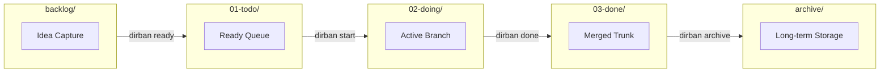

# CLI & Developer Reference

Command manual, interactive terminal shortcuts, and development workflows for Dirban.

---

### Installation

```bash
# Install globally via Bun or npm:
bun add -g dirban
# or: npm install -g dirban

# Or run directly with npx / bunx:
# npx dirban init

# Or download a standalone prebuilt binary from GitHub Releases:
# curl -fsSL https://github.com/SYip/dirban/releases/latest/download/dirban-$(uname -s | tr '[:upper:]' '[:lower:]')-$(uname -m) -o ~/.local/bin/dirban
```

---

## 1. User CLI Reference (`dirban`)

The `dirban` command provides deterministic, scriptable task and board operations driven by a cohesive 5-verb lifecycle:



### Synopsis

```bash
dirban [command] [options]
```

If run without arguments in an interactive terminal, `dirban` launches the interactive TUI (`dirban board`).

---

### Commands

#### `init`
Initializes the Kanban board directory structure on disk (`backlog/`, `01-todo/`, `02-doing/`, `03-done/`, and `archive/`) and configures settings.

- If `.vscode/` exists in the workspace, it automatically adds `"dirban.*"` settings to `.vscode/settings.json`.
- Otherwise, it creates `.dirban.json`.

```bash
# Auto-detects (.vscode/settings.json if .vscode exists, else .dirban.json)
dirban init

# Explicitly force configuration target
dirban init --config=vscode
dirban init --config=dirban
```

#### `next-id`
Prints the next available sequential task ID formatted as `YY-001` (derived from existing tasks in the workspace for the current year).

```bash
# Print next available ID
dirban next-id
# Output: 26-002
```

#### `priorities`
Lists all configured priority levels and highlights the workspace default priority.

```bash
dirban priorities
# Output:
# Available priorities: p0, p1, p2 (default), p3
```

#### `next`
Recommends the single top-priority task ready to be worked on from the queue preceding the focus column (e.g. `01-todo`).

- **Priority Sorting**: Inspects `p0` $\rightarrow$ `p1` $\rightarrow$ `p2` $\rightarrow$ `p3`, ordered by recency.
- **Empty Queue Guidance**: If no tasks remain in `01-todo`, suggests running `dirban plan` to promote unblocked tasks from the backlog.
- **Scriptability (`--raw`)**: Outputs only the task ID, allowing direct shell composition like `dirban start $(dirban next --raw)`.

```bash
# Display formatted recommendation with acceptance criteria and start instructions
dirban next

# Output bare task ID for shell composition
dirban next --raw
# Output: 26-001

# Automatically start the next scheduled task
dirban start $(dirban next --raw)
```

#### `current [id]` (alias: `focus`)
Displays the active task currently being executed.

- **Explicit Selection**: When passed `<id>`, immediately displays that task.
- **Git Branch / Worktree Detection**: When in a Git repository, detects the task ID from the branch name (`task/<id>-<slug>`) or isolated worktree directory name.
- **Filesystem Fallback (`02-doing`)**: If on `main` or non-task branch (or outside Git):
  - If 0 tasks in `02-doing`: cleanly prints `No task currently in progress.`
  - If 1 task in `02-doing`: displays that task.
  - If multiple tasks in `02-doing`: selects the highest-priority task (with deterministic recency/ID tie-breaker) and prints an informative notice.
- **AI Agent Streaming (`--raw`)**: Pass `--raw` to output the unformatted Markdown file directly to `stdout` for scripts and AI prompt piping.

```bash
# Show active task based on current Git branch or doing column
dirban current

# Stream raw Markdown to stdout for agent prompting
dirban current --raw

# Focus on a specific task
dirban focus 26-003
```

#### `start <id>` (alias: `worktree add`)
Moves the task to `02-doing` on disk, then checks out a task branch or provisions an isolated Git worktree.

- **Filesystem Move First**: Moves task card into `02-doing`.
- **Branch Derivation**: Deterministically derives the branch name: `task/<id>-<slug>`.
- **Execution Strategies**:
  - `--checkout`: Checks out or creates an in-place branch in the current repository.
  - `--worktree`: Provisions an isolated sibling git worktree in `../.<repo>.worktrees/<id>-<slug>`.
  - Configurable default strategy via `dirban.branchStrategy` (`"checkout"` [default] or `"worktree"`).
- **Graceful Non-Git Fallback**: If Git is not installed or the directory is not a Git repo, cleanly notifies the user and proceeds with the filesystem move without error.

```bash
# Start task using default configured strategy
dirban start 26-003

# Force in-place branch checkout
dirban start 26-003 --checkout

# Force isolated sibling worktree
dirban start 26-003 --worktree
```

#### `done [id]` (alias: `finish`)
Completes execution of a task card and transitions it to `03-done`.

- **Resolution**: Completes the specified `<id>` or auto-resolves the active task via `current`.
- **Filesystem Move**: Atomically moves the card file to `03-done`.
- **Criteria Awareness**: Does not auto-check boxes. If incomplete criteria remain, Dirban prints an alert before completing.
- **Git Auto-Merge**:
  - If on a task branch: auto-merges the task branch into the base branch (`main`) and switches back to `main`.
  - If inside a task worktree: auto-merges the task branch into `main` and cleans up the worktree directory via `git worktree remove`.
  - If outside Git or on `main`: cleanly moves the card to `03-done` and skips git merge.

```bash
# Finish currently active task
dirban done

# Finish specific task by ID
dirban done 26-003
```

#### `path [id|main]`
Prints the absolute filesystem path for a task worktree or the main repository.

Ideal for shell command substitution (`cd $(dirban path ...)`), terminal navigation, and AI agents.

```bash
# Jump to the main repository root
cd $(dirban path)

# Jump to task 26-003's isolated worktree
cd $(dirban path 26-003)
```

#### `new "<title>"` (alias: `create`)
Creates a new Markdown task file with an auto-assigned `YY-001` ID, slugified filename, and structured frontmatter.

```bash
# Create a task in the default backlog column
dirban new "Implement search filter across board"

# Create with specific priority and target column
dirban new "Fix critical token expiry bug" --priority=p0 --column=01-todo

# Create with tags and assignee
dirban new "OAuth2 backend integration" --tags=auth,api --assignee=andrew
```

#### `board`
Displays the Kanban board. Launches the interactive TUI if stdin is an interactive TTY, or formats a static table if `--static` is passed.

```bash
# Launch interactive TUI
dirban board

# Render static board table to stdout
dirban board --static

# Filter tasks by tag
dirban board --tag=cli

# Filter tasks by owner or assignee
dirban board --owner=developer
dirban board --owner=agent

# Search keyword across title, ID, or task body
dirban board --search="fuzzy"

# Sort tasks within columns (modes: priority [default], recency, id)
dirban board --sort=recency
dirban board --sort=id
```

#### `view <id|query>`
Inspects metadata, tags, priority, dependencies, and acceptance criteria checklist for a task.

Supports fuzzy substring lookup by keyword across task IDs, titles, and filenames. If multiple tasks match the query, it lists the matching candidates to prompt for disambiguation.

```bash
# View by exact ID or filename
dirban view 26-001

# View using fuzzy keyword slug
dirban view refactor

# Inspect and open the Markdown file in your default $EDITOR / VS Code
dirban view 26-001 --open
```

#### `move <id> <target-column>`
Atomically moves a task file to the target column directory.

> [!IMPORTANT]
> **Exact Identification for Mutating Operations**: State-mutating commands (`move`, `check`, `set`, `archive`) require an exact task ID, exact filename, or file path. Fuzzy substring resolution is intentionally disabled for mutations to prevent accidentally moving or modifying the wrong task.

```bash
dirban move 26-001 02-doing
dirban move 26-001 03-done
```

> **Note**: Because the directory *is* the state, you can also move tasks using standard Unix commands:
> ```bash
> mv docs/tasks/01-ready/26-001-task.md docs/tasks/02-in-progress/
> ```

#### `check <id> <index>`
Toggles an acceptance criteria checklist item (`- [ ]` $\leftrightarrow$ `- [x]`) by its 1-based index.

```bash
# Toggles the 1st checkbox in task 26-001
dirban check 26-001 1
```

#### `set <id> [options]`
Mutates frontmatter metadata for a task while preserving all body content and structure.

```bash
# Set priority (p0, p1, p2, p3)
dirban set 26-001 --priority=p0

# Set assignee or owner
dirban set 26-001 --assignee=andrew
dirban set 26-001 --owner=agent

# Update title
dirban set 26-001 --title="Implement fuzzy search across board"

# Update tags (comma-separated)
dirban set 26-001 --tags=cli,search,ux
```

#### `archive [<id>|all]`
Moves completed tasks directly into terminal archive storage (`archive/`).

```bash
# Archive a specific completed task
dirban archive 26-001

# Archive all tasks currently in the done column
dirban archive all
```

#### `ready <id...> [options]`
Moves unblocked task(s) from `backlog` into the active queue (`01-todo` or configured first active column). Completes the natural 5-verb lifecycle: `new` -> `ready` -> `start` -> `done` -> `archive`.

```bash
# Ready a single task by ID or short numeric suffix
dirban ready 26-004
dirban ready 004

# Ready multiple tasks at once
dirban ready 004 005 006

# Ready all unblocked tasks currently in backlog
dirban ready all

# Ready to a specific target column
dirban ready 004 --to=01-todo
```

#### `plan [options]`
Displays backlog planning and triage view. Partitions unstarted tasks into **Ready to Schedule** vs. **Blocked / In Limbo** based on dependency resolution against done columns and `archive/`.

```bash
# Formatted static terminal view
dirban plan

# Agent scriptable flag: list only unblocked tasks ready for scheduling (alias: --no-blocked)
dirban plan --unblocked
dirban plan --no-blocked

# Agent scriptable flag: list only blocked tasks and blocking sources
dirban plan --blocked

# Launch interactive terminal planner (Space to toggle select)
dirban plan --interactive
dirban plan -i
```

#### `block <id> <reasons...>`
Records dependencies or blocker reasons on a task (appended to `relationships.depends_on`) and automatically demotes the task from active workflow columns back to `backlog/` to free the active WIP slot.

```bash
# Block by another task ID (auto-resolves when that task reaches done/archive)
dirban block 26-002 26-001

# Block by task file path (automatically resolves to canonical ID)
dirban block 26-002 docs/tasks/01-todo/26-001-setup.md

# Block by freeform text reasons or URLs
dirban block 26-002 "Waiting for API credentials" "PR #42 review"

# Block with comma-separated arguments
dirban block 26-002 "Waiting for security signoff, Upstream backend deployment"
```

#### `unblock <id> [reason]`
Removes specific blockers or dependency references from a task.

```bash
# Unblock a specific blocker reason or task ID
dirban unblock 26-002 "Waiting for API credentials"
dirban unblock 26-002 26-001

# If only a single blocker exists, automatically clears it without argument
dirban unblock 26-002
```

#### `help` / `--help` / `-h`
Displays usage syntax and flags.

#### `--version` / `-v`
Outputs the current version string.

---

## 2. Interactive Terminal UI (TUI) Keybindings

When running `dirban board` in a terminal TTY, the interactive TUI is launched.

| Key | Action |
| :--- | :--- |
| `←` / `h` | Move focus to previous column |
| `→` / `l` | Move focus to next column |
| `↑` / `k` | Move focus to previous task card |
| `↓` / `j` | Move focus to next task card |
| `m` | Open interactive modal to move selected task to another column |
| `Space` | Toggle the first incomplete acceptance criteria checklist item |
| `v` / `Enter` | Open full task detail preview overlay (press `ESC` or `Enter` to return) |
| `q` / `Ctrl+C` | Exit the TUI |

---

## 3. Developer CLI Reference

For contributors developing the Dirban engine:

### Prerequisites
- **Runtime**: [Bun](https://bun.sh) (v1.2+)
- **TypeScript**: v5.8+

### Development Scripts

| Command | Description |
| :--- | :--- |
| `bun run dirban [args]` | Runs the CLI directly from TypeScript source (`main.ts`) |
| `bun test` | Runs the full vector-based test suite via Bun's native test runner |
| `bun run typecheck` | Runs TypeScript compiler checks without emitting files (`tsc --noEmit`) |
| `bun run build` | Compiles `main.ts` into a standalone, zero-dependency native executable (`./dirban`) |
| `bun link` | Symlinks the local `dirban` executable into your global bin PATH |
| `bun run seed-tasks.ts` | Populates sample tasks across columns for local development and TUI testing |

---

## 4. Configuration Reference (`.dirban.json`)

Dirban automatically resolves configuration from `.dirban.json` located in the workspace root.

For detailed workflow recipes (Minimalist, Enterprise Multi-Stage, Direct Intake, and Git Worktrees), see the **[Configuration Guide](concepts/configuration.md)**.

| Property | Type | Default | Description |
| :--- | :--- | :--- | :--- |
| `tasksDir` | `string` | `"docs/tasks"` | Root directory containing column subdirectories |
| `columns` | `string[]` | `["01-todo", "02-doing", "03-done"]` | Ordered list of active workflow column folder names (`backlog/` and `archive/` are intrinsic reserved tiers) |
| `focusColumn` | `string` | `"02-doing"` | Name of the primary in-progress column (defaults to `columns[1]` or `columns[0]`). If `columns: []`, focus is `null` |
| `priorities` | `string[]` | `["p0", "p1", "p2", "p3"]` | Ordered list of priority levels (index 0 is highest priority) |
| `defaultPriority` | `string` | `"p2"` | Default priority assigned to newly created tasks (must be in `priorities`) |
| `branchStrategy` | `"checkout" \| "worktree" \| "none"` | `"checkout"` | Workspace strategy when starting a task |
| `branchPrefix` | `string` | `"task/"` | Prefix applied to Git task branches |
| `autoMerge` | `boolean` | `true` | Automatically squash and merge the task branch upon `dirban done` |
| `archiveDir` | `string` | `"docs/tasks/archive"` | Directory where archived tasks are moved |
